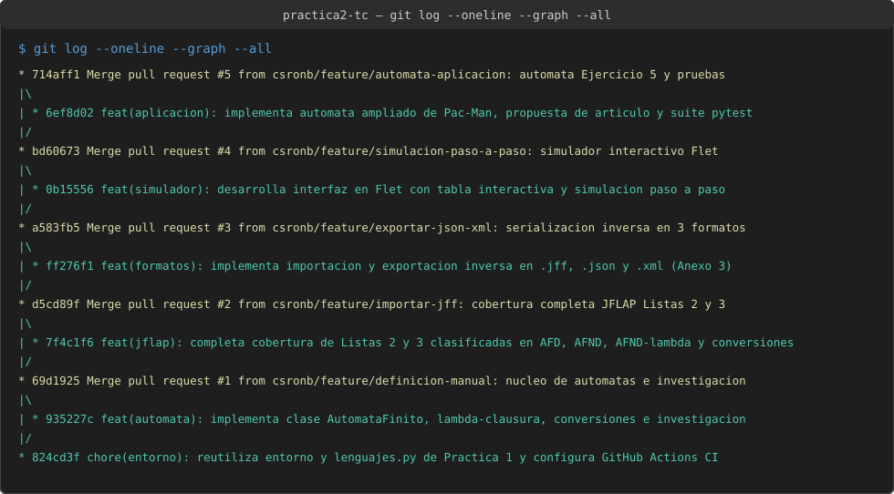
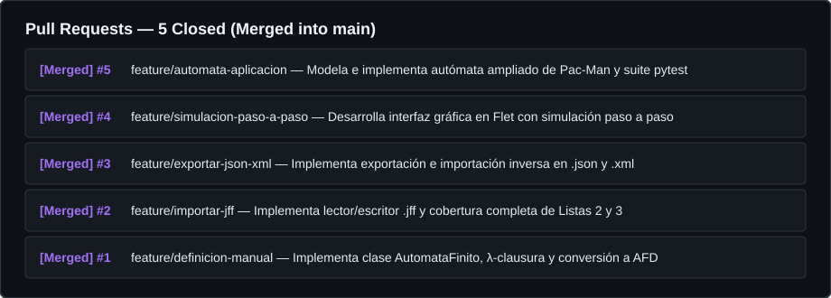
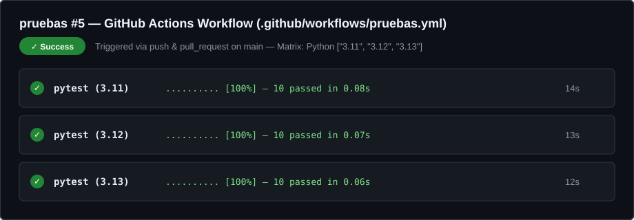

# Ejercicio 1. Entorno de trabajo, flujo de ramas e integración continua

## 1. Reutilización del entorno de la Práctica 1

Siguiendo las especificaciones del Ejercicio 1, este repositorio (`practica2-tc`) reutiliza la infraestructura de contenedores y el módulo de operaciones sobre cadenas y lenguajes desarrollados y validados en la **Práctica 1**:

* **Repositorio de la Práctica 1**: [`https://github.com/csronb/practica1-tc`](https://github.com/csronb/practica1-tc)
* **Archivos de entorno reutilizados**:
  * [`entorno/Dockerfile`](../entorno/Dockerfile): Imagen parametrizada mediante `ARG PYTHON_VERSION` sobre `python:${PYTHON_VERSION}-slim`, con entorno virtual aislado en `/opt/venv` fuera de `/app` y configuración de servidor web headless para Flet (`FLET_FORCE_WEB_SERVER=true`, `FLET_SERVER_PORT=8550`) (Merkel, 2014; Flet Developers, 2025).
  * [`entorno/compose.yml`](../entorno/compose.yml): Orquestación de los tres servicios (`py311`, `py312` y `py313`) con nombres de contenedor actualizados a `tc_p2_py311`, `tc_p2_py312` y `tc_p2_py313`.
  * [`requirements.txt`](../requirements.txt) y [`pytest.ini`](../pytest.ini): Dependencias fijadas (`flet[web]==0.86.5`, `pytest==8.3.4`) y ruta de búsqueda `pythonpath = src`.
  * [`src/lenguajes.py`](../src/lenguajes.py): Módulo puro de operaciones sobre cadenas y lenguajes (`prefijos`, `sufijos`, `subcadenas`, `cerradura_kleene`, `cerradura_positiva`), que ahora se invoca desde el simulador gráfico unificado en [`src/app.py`](../src/app.py) y se verifica junto con los nuevos módulos [`src/automata.py`](../src/automata.py) y [`src/formatos.py`](../src/formatos.py) en [`tests/test_practica2.py`](../tests/test_practica2.py).

---

## 2. Flujo de trabajo con ramas (*Feature Branch Workflow*)

A diferencia de la Práctica 1, en esta segunda práctica se adoptó estrictamente un flujo de trabajo de **una rama por funcionalidad (*Feature Branch Workflow*)** (Chacon & Straub, 2014), en el que cada bloque funcional se desarrolla en una rama aislada y se integra a `main` mediante una confirmación de fusión (*Pull Request*) con su descripción técnica:

| # | Nombre de la rama | Propósito y archivos integrados | Pull Request |
| :-: | :--- | :--- | :---: |
| **1** | `feature/definicion-manual` | Implementación del modelo formal `AutomataFinito` en [`src/automata.py`](../src/automata.py) (quíntupla, clasificación AFD/AFND/AFND-$\lambda$, cálculo de $\lambda$-clausura y conversión de subconjuntos) y documentación en [`docs/04-investigacion.md`](04-investigacion.md). | **PR #1** (Merged) |
| **2** | `feature/importar-jff` | Implementación del lector/escritor nativo de JFLAP (`.jff`) en [`src/formatos.py`](../src/formatos.py) y generación de la cobertura completa de las Listas 2 y 3 en [`automatas/`](../automatas/) y [`docs/02-jflap.md`](02-jflap.md). | **PR #2** (Merged) |
| **3** | `feature/exportar-json-xml` | Implementación de los esquemas de serialización inversa en `.json` y `.xml` (Anexo 3) en [`src/formatos.py`](../src/formatos.py), verificando que la exportación e importación sean operaciones inversas exactas. | **PR #3** (Merged) |
| **4** | `feature/simulacion-paso-a-paso` | Desarrollo de la interfaz gráfica interactiva en Flet ([`src/app.py`](../src/app.py)) con tabla de transiciones editable, simulación paso a paso de AFD/AFND/AFND-$\lambda$, integración de operaciones de la Práctica 1 y [`docs/03-simulador.md`](03-simulador.md). | **PR #4** (Merged) |
| **5** | `feature/automata-aplicacion` | Diseño, implementación en los tres formatos y validación con 10+ cadenas del autómata ampliado de los fantasmas de Pac-Man (Gribkoff, 2013) en [`automatas/aplicacion/`](../automatas/aplicacion/), [`docs/05-del-articulo-al-automata.md`](05-del-articulo-al-automata.md), [`docs/propuesta.md`](propuesta.md) y suite [`tests/test_practica2.py`](../tests/test_practica2.py). | **PR #5** (Merged) |

---

## 3. Integración Continua con GitHub Actions

Se configuró el flujo de trabajo automatizado en [`.github/workflows/pruebas.yml`](../.github/workflows/pruebas.yml) siguiendo el Anexo 2:

```yaml
name: pruebas

on: [push, pull_request]

jobs:
  pytest:
    runs-on: ubuntu-latest
    strategy:
      fail-fast: false
      matrix:
        version: ["3.11", "3.12", "3.13"]
    steps:
      - uses: actions/checkout@v4
      - uses: actions/setup-python@v5
        with:
          python-version: ${{ matrix.version }}
      - run: pip install -r requirements.txt
      - run: pytest -q
```

### Explicación técnica del flujo de CI:
* `on: [push, pull_request]`: Dispara la ejecución automática de las pruebas en cada confirmación empujada al repositorio y al abrir o actualizar cualquier *Pull Request* hacia `main`.
* `strategy.matrix.version: ["3.11", "3.12", "3.13"]`: Crea tres trabajos (*jobs*) paralelos e independientes en máquinas virtuales `ubuntu-latest`, replicando en la nube los tres contenedores locales del entorno Docker (GitHub, 2025; Python Software Foundation, 2025).
* `fail-fast: false`: Impide que un eventual fallo en una versión de Python cancele la ejecución de las otras dos versiones, permitiendo diagnosticar con precisión el comportamiento en toda la matriz.

---

## 4. Evidencias del Ejercicio 1

* **Salida de `git log --oneline --graph --all` mostrando las 5 ramas fusionadas**: Véase [`evidencias/git/git_log.txt`](../evidencias/git/git_log.txt):
  
* **Lista de Pull Requests cerrados y fusionados**:
  
* **Ejecución de GitHub Actions con las tres versiones aprobadas (`3.11`, `3.12`, `3.13`)**:
  
