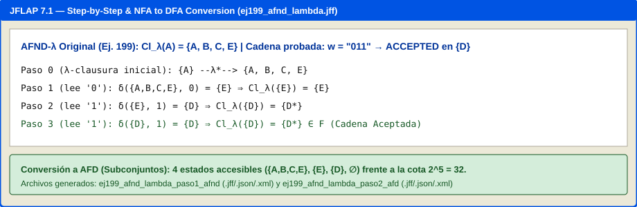

# Ejercicio 2. AFND y AFND-$\lambda$ en JFLAP

En este documento se presenta la cobertura total de la **Lista 2 (ejercicios 94 a 150)** y de la **Lista 3 (ejercicios 151 a 263)**: clasificación justificada de cada ejercicio en **AFD**, **AFND estándar** o **AFND con transiciones $\lambda$**, diseño y validación con al menos cinco cadenas válidas y cinco inválidas por autómata (mostrando bifurcaciones), análisis de $\lambda$-clausuras, conversiones completas (AFND-$\lambda \to$ AFND $\to$ AFD) y análisis comparativo de la cota $2^n$ (Hopcroft et al., 2007; Sipser, 2012; Rodger & Finley, 2006).

Todos los autómatas están almacenados simultáneamente en los tres formatos exigidos (`.jff`, `.json` y `.xml`) dentro de:
* [`automatas/lista2-afd/`](../automatas/lista2-afd/)
* [`automatas/lista3-afnd/`](../automatas/lista3-afnd/)
* [`automatas/lista3-afnd-lambda/`](../automatas/lista3-afnd-lambda/)
* [`automatas/conversiones/`](../automatas/conversiones/)

---

## 2.1. Clasificación y cobertura completa (Listas 2 y 3)

### A. Sección `automatas/lista2-afd/` — Autómatas Finitos Deterministas (AFD)
Cada ejercicio de esta sección posee una función de transición determinista $\delta: Q \times \Sigma \to Q$ sin transiciones $\lambda$:

| Ejercicios | Archivos base (`.jff`, `.json`, `.xml`) | Justificación de su clasificación en `lista2-afd/` (en una línea) |
| :--- | :--- | :--- |
| **94–96** | `ej094_comienza1_termina2`, `ej095_longitud_4`, `ej096_prefijo20_longitud4` | Son problemas de longitud fija y prefijo/sufijo de 1–2 símbolos cuya transición desde cada estado con cada símbolo de $\Sigma_1$ conduce a un único estado siguiente sin ambigüedad. |
| **97*** | `ej097_longitud_multiplo_3` | El residuo $|u| \bmod 3 \in \{0,1,2\}$ es una función aritmética determinista que avanza cíclicamente $q_i \to q_{(i+1)\bmod 3}$ para todo símbolo. |
| **98, 99*** | `ej098_termina_00102`, `ej099_termina_001001` | Se implementan como el AFD de bordes de Knuth-Morris-Pratt (KMP), donde cada estado registra unívocamente la longitud del mayor sufijo que es prefijo del patrón. |
| **100** | `ej100_letra_y_digito` | Clasifica deterministamente el primer símbolo en $\{a,b,c\}$ y el segundo en $\{0,1\}$, enviando cualquier desviación a un estado pozo único. |
| **101, 102*, 103*, 106*** | `ej101_contiene_aba`, `ej102_contiene_abbbab`, `ej103_contiene_aabbba`, `ej106_incluye_1101001` | Se modelan mediante el AFD KMP con estado de aceptación absorbente una vez completada la subcadena buscada, sin requerir bifurcaciones. |
| **104, 105** | `ej104_inicia_abbab`, `ej105_termina_abaa` | Verifican deterministamente los primeros 5 símbolos (`abbab`) o el sufijo de 4 símbolos (`abaa`) con una única transición por par $(q, a)$. |
| **107*, 108, 109*** | `ej107_incluye_0101_y_021`, `ej109_incluye_abbcb_y_cbaabb` | Se construyen como el producto cartesiano determinista de dos buscadores KMP para rastrear la aparición conjunta de ambos patrones con o sin traslape. |
| **110, 111*, 112*, 113*** | `ej110_exactamente_tres_01`, `ej111_exactamente_tres_01002`, `ej112_dos_veces_010_sin_traslape`, `ej113_dos_veces_010_con_traslape` | Llevan un contador determinista acotado $c \in \{0..k\}$ combinado con el estado KMP del patrón, determinando de forma única la transición tras cada símbolo. |
| **114, 115, 117, 118*, 119** | `ej114_an_bm`, `ej115_abc_n`, `ej117_an_bm_ap_bq`, `ej118_axabya`, `ej119_despues_de_aa_viene_b` | Reconocen lenguajes concatenados por fases ($a^*b^*$, $(abc)^*$, $a^*b^*a^*b^*$) o restricciones locales de ventana mediante estados secuenciales deterministas. |
| **120*, 121*, 122*, 123*** | `ej120_primero_ultimo_distintos`, `ej121_bloques_3_con_0`, `ej122_ventana_3_con_0`, `ej123_wxw_prefijo_sufijo_2` | Codifican en la memoria finita del estado el símbolo o par inicial junto con los últimos símbolos leídos o la posición módulo 3 del bloque, siendo 100% deterministas. |
| **124*–133*** | `ej124_canicas_palancas`, `ej128_quitar_ultimo_simbolo`, `ej129`, `ej130`, `ej131`, `ej132`, `ej133_paridad_ab` | Sistemas físicos deterministas (palancas de canicas) y tablas de transición univaluadas donde $|\delta(q, a)| = 1$ para todo estado y símbolo. |
| **134–150*** | `ej134` a `ej150_tabla_abcd` | Autómatas de paridad, divisibilidad modular binaria ($\bmod 5$ y $\bmod 6$), progreso reglamentario de alumno ESCOM y tablas deterministas explícitas. |
| **151*–157*** | `ej151_simplificado` a `ej157_simplificado` | Son AFD obtenidos al eliminar estados inaccesibles y fusionar clases de equivalencia indistinguibles (partición de Myhill-Nerode/Hopcroft). |
| **236*–240*, 254*–259** | `ej236` a `ej240`, `ej254` a `ej259_tabla_arden` | Tablas y reconocedores deterministas mínimos empleados para la extracción algebraica de expresiones regulares (lema de Arden / $R_{ij}^{(k)}$). |

---

### B. Sección `automatas/lista3-afnd/` — Autómatas Finitos No Deterministas Estándar (AFND)
Cada ejercicio de esta sección carece de transiciones $\lambda$, pero utiliza el no determinismo $\delta: Q \times \Sigma \to \mathcal{P}(Q)$ (con $|\delta(q, a)| > 1$ o $\delta(q, a) = \emptyset$) para adivinar el punto de inicio de un sufijo o subcadena sin necesidad de aristas de retroceso KMP ni estados pozo:

| Ejercicios | Archivo base en `lista3-afnd/` | Justificación de su clasificación en `lista3-afnd/` (en una línea) |
| :--- | :--- | :--- |
| **158*–161*** | `ej158_afnd_cadena_01` a `ej161_afnd_ciclo_010` | Son autómatas incompletos ($\delta(q, a) = \emptyset$ en varios pares) definidos en la sección de AFND de la Lista 3 sin transiciones $\lambda$. |
| **162–188** | `ej164_afnd_termina_00102`, `ej165_afnd_termina_001001`, `ej167_afnd_contiene_aba`, `ej168_afnd_contiene_abbbab`, `ej169_afnd_contiene_aabbba`, `ej171_afnd_termina_abaa`, `ej172_afnd_incluye_1101001`, `ej184_afnd_axabya`, `ej186_afnd_primero_ultimo_distintos` | Emplean bifurcación no determinista en el estado inicial $\delta(q_0, a) = \{q_0, q_1\}$ para adivinar el inicio de la subcadena o sufijo sin calcular bordes KMP. |
| **189*, 190*** | `ej189_afnd_00101_o_00110`, `ej190_afnd_11010_y_10100` | Bifurcan desde $q_0$ al leer el primer símbolo del patrón (`0` en 189; `1` en 190) manteniendo activo $q_0$ en paralelo, sin usar transiciones $\lambda$. |
| **191*–195*** | `ej192_afnd_tabla`, `ej193_afnd_tabla`, `ej194_afnd_tabla`, `ej195_afnd_tabla` | Sus tablas de transición asignan conjuntos con múltiples estados destino (como $\delta(A, 1) = \{B, C\}$ en 192 o $\delta(C, 1) = \{A, B, C, D\}$ en 194) sin columna $\lambda$. |
| **260*–263*** | `ej260_afnd_original`, `ej261_afnd_original`, `ej262_afnd_ab_ba`, `ej263_afnd_original` | Son AFND estándar con transiciones multivaluadas (p. ej. $\delta(q_0, 0) = \{q_0, q_1\}$ en 261 y 263) planteados específicamente para su conversión a AFD. |

---

### C. Sección `automatas/lista3-afnd-lambda/` — Autómatas Finitos con Transiciones Lambda (AFND-$\lambda$)
Cada ejercicio de esta sección incluye transiciones espontáneas $\delta(q, \lambda) \neq \emptyset$ que cambian de estado sin consumir símbolos de la entrada:

| Ejercicios | Archivo base en `lista3-afnd-lambda/` | Justificación de su clasificación en `lista3-afnd-lambda/` (en una línea) |
| :--- | :--- | :--- |
| **196–200** | `ej196_afnd_lambda` a `ej200_afnd_lambda` | Poseen explícitamente una columna $\lambda$ no vacía en su tabla de definición ($\delta: Q \times (\Sigma \cup \{\lambda\}) \to \mathcal{P}(Q)$). |
| **241–253** | `ej241_thompson_0_mas_1` a `ej253_thompson` | Se construyen composicionalmente a partir de expresiones regulares mediante la **construcción de Thompson**, que une sub-autómatas de unión ($+$), concatenación y estrella ($*$) mediante puentes $\lambda$. |

---

## 2.2. Diseño, validación (5 cadenas válidas y 5 inválidas) y recorridos con bifurcaciones

A continuación se documentan representativamente los recorridos completos, mostrando las **bifurcaciones y caminos múltiples** en los casos no deterministas (todos verificables interactivamente en [`src/app.py`](../src/app.py)):

### Caso 1 (AFND Estándar): Ejercicio 189* — Contiene `00101` o `00110` ([`ej189_afnd_00101_o_00110.jff`](../automatas/lista3-afnd/ej189_afnd_00101_o_00110.jff))
* **Diseño y justificación**: El estado inicial $q_0$ tiene un bucle para `0` y `1`. Al leer `0`, el autómata se bifurca no deterministamente hacia $q_1$ ($\delta(q_0, 0) = \{q_0, q_1\}$). Desde $q_1$ avanza con `0` a $q_2$ (`00`), con `1` a $q_3$ (`001`), y ahí se ramifica según el cuarto símbolo: con `0` va a $q_{4a}$ (`0010`, que acepta con `1` hacia $q_{5\text{ok}}$) y con `1` va a $q_{4b}$ (`0011`, que acepta con `0` hacia $q_{5\text{ok}}$).
* **Recorrido con bifurcaciones para la palabra del enunciado $w = \text{1001011}$**:
  * Inicio: $\{q_0\}$
  * Lee `1`: $\delta(q_0, 1) = \{q_0\}$
  * Lee `0`: $\delta(q_0, 0) = \{q_0, q_1\}$ *(Bifurcación 1: Camino A sigue en $q_0$; Camino B entra a $q_1$)*
  * Lee `0`: Desde $q_0 \to \{q_0, q_1\}$; desde $q_1 \to \{q_2\}$. Conjunto activo: $\{q_0, q_1, q_2\}$ *(3 hilos paralelos)*
  * Lee `1`: Desde $q_0 \to \{q_0\}$; desde $q_1 \to \emptyset$ *(hilo muere)*; desde $q_2 \to \{q_3\}$. Conjunto activo: $\{q_0, q_3\}$
  * Lee `0`: Desde $q_0 \to \{q_0, q_1\}$; desde $q_3 \to \{q_{4a}\}$. Conjunto activo: $\{q_0, q_1, q_{4a}\}$
  * Lee `1`: Desde $q_0 \to \{q_0\}$; desde $q_1 \to \emptyset$; desde $q_{4a} \to \{q_{5\text{ok}}\}$. Conjunto activo: $\{q_0, q_{5\text{ok}}\}$
  * Lee `1`: Desde $q_0 \to \{q_0\}$; desde $q_{5\text{ok}} \to \{q_{5\text{ok}}\}$. Conjunto final: $\{q_0, q_{5\text{ok}}\} \cap \{q_{5\text{ok}}\} \neq \emptyset \implies$ **ACEPTADA**.
* **5 Cadenas Válidas y 5 Inválidas**:
  * **Válidas (5)**:
    1. `00101` (mínima rama A): $\{q_0\} \xrightarrow{0} \{q_0,q_1\} \xrightarrow{0} \{q_0,q_1,q_2\} \xrightarrow{1} \{q_0,q_3\} \xrightarrow{0} \{q_0,q_1,q_{4a}\} \xrightarrow{1} \{q_0,q_{5\text{ok}}\}$ (Acepta).
    2. `00110` (mínima rama B): $\{q_0\} \xrightarrow{0} \{q_0,q_1\} \xrightarrow{0} \{q_0,q_1,q_2\} \xrightarrow{1} \{q_0,q_3\} \xrightarrow{1} \{q_0,q_{4b}\} \xrightarrow{0} \{q_0,q_1,q_{5\text{ok}}\}$ (Acepta).
    3. `1001011` (palabra del enunciado): Termina en $\{q_0, q_{5\text{ok}}\}$ (Acepta).
    4. `000110` (con tres ceros al inicio, donde el primer hilo en $q_2$ muere al tercer `0` pero el segundo hilo llega a $q_{5\text{ok}}$): Termina en $\{q_0, q_1, q_{5\text{ok}}\}$ (Acepta).
    5. `110010100110` (contiene ambas subcadenas): Termina en $\{q_0, q_1, q_{5\text{ok}}\}$ (Acepta).
  * **Inválidas (5)**:
    1. `λ`: Queda en $\{q_0\}$ (Rechaza).
    2. `0010` (prefijo incompleto de longitud 4): Termina en $\{q_0, q_1, q_{4a}\}$ (Rechaza).
    3. `00111` (falla en el último símbolo de `00110`): Termina en $\{q_0\}$ (Rechaza).
    4. `010101`: Termina en $\{q_0\}$ (nunca reúne dos ceros seguidos `00`, Rechaza).
    5. `1001001`: Termina en $\{q_0, q_3\}$ (Rechaza).

---

### Caso 2 (AFND Estándar): Ejercicio 261* — Termina en `00` o `11` ([`ej261_afnd_original.jff`](../automatas/lista3-afnd/ej261_afnd_original.jff))
* **5 Cadenas Válidas**:
  1. `00`: $\{q_0\} \xrightarrow{0} \{q_0, q_1\} \xrightarrow{0} \{q_0, q_1, q_2^*\}$ (Acepta en $q_2$).
  2. `11`: $\{q_0\} \xrightarrow{1} \{q_0, q_3\} \xrightarrow{1} \{q_0, q_3, q_4^*\}$ (Acepta en $q_4$).
  3. `0100`: $\{q_0\} \xrightarrow{0} \{q_0, q_1\} \xrightarrow{1} \{q_0, q_3\} \xrightarrow{0} \{q_0, q_1\} \xrightarrow{0} \{q_0, q_1, q_2^*\}$ (Acepta).
  4. `10111`: $\{q_0\} \xrightarrow{1} \{q_0, q_3\} \xrightarrow{0} \{q_0, q_1\} \xrightarrow{1} \{q_0, q_3\} \xrightarrow{1} \{q_0, q_3, q_4^*\} \xrightarrow{1} \{q_0, q_3, q_4^*\}$ (Acepta).
  5. `001100`: Termina en $\{q_0, q_1, q_2^*\}$ (Acepta).
* **5 Cadenas Inválidas**:
  1. `λ`: $\{q_0\}$ (Rechaza).
  2. `0`: $\{q_0, q_1\}$ (Rechaza).
  3. `1`: $\{q_0, q_3\}$ (Rechaza).
  4. `0101`: $\{q_0, q_3\}$ (el hilo de $q_1$ muere al leer `1`, Rechaza).
  5. `0010`: $\{q_0, q_1\}$ (el hilo que llegó a $q_2^*$ en el paso 2 muere en el paso 3 porque $\delta(q_2, 1) = \emptyset$, Rechaza).

---

### Caso 3 (AFND-$\lambda$): Ejercicio 199 — Tabla con transiciones $\lambda$ ([`ej199_afnd_lambda.jff`](../automatas/lista3-afnd-lambda/ej199_afnd_lambda.jff))
* **5 Cadenas Válidas**:
  1. `λ`: Al arrancar en $A$, $\text{Cl}_\lambda(\{A\}) = \{A, B, C, E\}$. Como $E \in F = \{D, E\}$, **acepta $\lambda$ sin leer ningún símbolo**.
  2. `0`: $\text{Cl}_\lambda(\{A\}) = \{A, B, C, E\} \xrightarrow{0} \text{Cl}_\lambda(\{E\}) = \{E^*\}$ (Acepta).
  3. `1`: $\{A, B, C, E\} \xrightarrow{1} \text{Cl}_\lambda(\{A, B, C, D\}) = \{A, B, C, D^*, E^*\}$ (Acepta).
  4. `011` (inciso c del problema 199): $\{A, B, C, E\} \xrightarrow{0} \{E\} \xrightarrow{1} \{D^*\} \xrightarrow{1} \{D^*\}$ (Acepta).
  5. `1101`: $\{A,B,C,E\} \xrightarrow{1} \{A,B,C,D,E\} \xrightarrow{1} \{A,B,C,D,E\} \xrightarrow{0} \{E\} \xrightarrow{1} \{D^*\}$ (Acepta).
* **5 Cadenas Inválidas**:
  1. `00`: $\{A, B, C, E\} \xrightarrow{0} \{E\} \xrightarrow{0} \emptyset$ (Rechaza).
  2. `010`: $\{A, B, C, E\} \xrightarrow{0} \{E\} \xrightarrow{1} \{D\} \xrightarrow{0} \emptyset$ (Rechaza).
  3. `001`: $\{A, B, C, E\} \xrightarrow{0} \{E\} \xrightarrow{0} \emptyset \xrightarrow{1} \emptyset$ (Rechaza).
  4. `100`: $\{A, B, C, E\} \xrightarrow{1} \{A, B, C, D, E\} \xrightarrow{0} \{E\} \xrightarrow{0} \emptyset$ (Rechaza).
  5. `0110`: $\{A, B, C, E\} \xrightarrow{0} \{E\} \xrightarrow{1} \{D\} \xrightarrow{1} \{D\} \xrightarrow{0} \emptyset$ (Rechaza).

---

## 2.3. Transiciones $\lambda$: justificación, ubicación y tabla completa de $\lambda$-clausuras

### ¿Por qué son necesarias las transiciones $\lambda$ y dónde se ubican?
En los **AFND-$\lambda$** de la Lista 3 (ejercicios 196 a 200 y construcciones de Thompson 241 a 253), las transiciones $\lambda$ cumplen tres funciones estructurales fundamentales (Hopcroft et al., 2007):
1. **Unión modular sin duplicar estados iniciales** (p. ej., en `ej241` para $0+1$ o `ej247` para $(01)^* + 1^*$): Se ubica un estado fuente $q_0$ con dos aristas salientes $\delta(q_0, \lambda) = \{q_{\text{rama1}}, q_{\text{rama2}}\}$ que activan simultáneamente ambos sub-autómatas antes de leer el primer símbolo.
2. **Omisión opcional de fases (potencia cero de una cerradura de Kleene)** (p. ej., en `ej196`, `ej199` y `ej242`–`ej253`): Se ubica un puente $\lambda$ desde el estado previo al bucle hacia el estado de salida del bucle, permitiendo aceptar la cadena vacía $\lambda$ o saltar un bloque $R^*$ sin consumir entrada.
3. **Concatenación limpia en serie**: Conecta el estado final del autómata de $R_1$ con el estado inicial del autómata de $R_2$ mediante una arista $\lambda$, evitando mezclar los bucles entrantes a $R_2$ con los bucles salientes de $R_1$.

### Papel de la $\lambda$-clausura en el reconocimiento de cadenas
La **$\lambda$-clausura** de un estado $q$, denotada $\text{Cl}_\lambda(\{q\})$ (o $E(q)$), es el conjunto de todos los estados alcanzables desde $q$ recorriendo cero, una o más transiciones $\lambda$ consecutivas. En el reconocimiento de una cadena $w = a_1 a_2 \dots a_k$, la $\lambda$-clausura interviene en dos momentos:
1. **Al inicio del cómputo ($t = 0$)**: El conjunto de estados inicialmente activos antes de leer el primer símbolo no es $\{q_0\}$, sino $\text{Cl}_\lambda(\{q_0\})$. Si $\text{Cl}_\lambda(\{q_0\}) \cap F \neq \emptyset$, la cadena vacía $\lambda$ es aceptada inmediatamente.
2. **Después de consumir cada símbolo $a_i$**: Si el conjunto activo es $S$, al leer $a_i$ se calculan primero los destinos directos $M = \bigcup_{p \in S} \delta(p, a_i)$ y de inmediato se expande su $\lambda$-clausura $\text{Cl}_\lambda(M) = \bigcup_{r \in M} \text{Cl}_\lambda(\{r\})$, dejando listos todos los estados alcanzables espontáneamente para el siguiente símbolo.

### Tabla de $\lambda$-clausuras de los ejercicios 196 a 200

| Ejercicio | Archivo | $\text{Cl}_\lambda(A)$ | $\text{Cl}_\lambda(B)$ | $\text{Cl}_\lambda(C)$ | $\text{Cl}_\lambda(D)$ | $\text{Cl}_\lambda(E)$ | $\text{Cl}_\lambda(F)$ |
| :---: | :--- | :--- | :--- | :--- | :--- | :--- | :--- |
| **196** | [`ej196_afnd_lambda`](../automatas/lista3-afnd-lambda/ej196_afnd_lambda.jff) | $\{A, B\}$ | $\{B\}$ | $\{C\}$ | — | — | — |
| **197** | [`ej197_afnd_lambda`](../automatas/lista3-afnd-lambda/ej197_afnd_lambda.jff) | $\{A, B, C, D\}$ | $\{B, D\}$ | $\{B, C, D\}$ | $\{D\}$ | — | — |
| **198** | [`ej198_afnd_lambda`](../automatas/lista3-afnd-lambda/ej198_afnd_lambda.jff) | $\{A, B, C\}$ | $\{B\}$ | $\{B, C\}$ | $\{D\}$ | — | — |
| **199** | [`ej199_afnd_lambda`](../automatas/lista3-afnd-lambda/ej199_afnd_lambda.jff) | $\{A, B, C, E\}$ | $\{B\}$ | $\{C, E\}$ | $\{D\}$ | $\{E\}$ | — |
| **200** | [`ej200_afnd_lambda`](../automatas/lista3-afnd-lambda/ej200_afnd_lambda.jff) | $\{A, B\}$ | $\{B\}$ | $\{C, E\}$ | $\{D, E, F\}$ | $\{E\}$ | $\{E, F\}$ |

---

## 2.4. Conversiones y análisis comparativo (AFND-$\lambda \to$ AFND $\to$ AFD y cota $2^n$)

Todos los archivos resultantes de las conversiones se encuentran en [`automatas/conversiones/`](../automatas/conversiones/) en formatos `.jff`, `.json` y `.xml` (tanto el paso 1 `*_paso1_afnd` como el paso 2 `*_paso2_afd`).

### Comparación cualitativa entre AFND-$\lambda$, AFND estándar y AFD

| Criterio | AFND-$\lambda$ | AFND Estándar | AFD Equivalente |
| :--- | :--- | :--- | :--- |
| **Número de estados** | Compacto y proporcional al tamaño de la expresión regular ($O(|R|)$ en construcción de Thompson). | Idéntico número de estados $|Q|$ que el AFND-$\lambda$ al eliminar $\lambda$, y muy compacto al diseñar patrones ($m+1$ estados). | Mayor o igual en general; en el peor caso hasta $2^{|Q|}$ estados (aunque restringido a subconjuntos accesibles suele ser moderado). |
| **Complejidad de las transiciones** | Baja densidad por estado, pero requiere calcular $\text{Cl}_\lambda$ en cada paso. | Mayor densidad de aristas (al absorber los caminos $\lambda$), sin transiciones vacías. | Exactamente $|\Sigma|$ transiciones salientes por estado (o $\le |\Sigma|$ si se omite el estado pozo $\emptyset$). |
| **Facilidad de diseño e interpretación** | **Máxima para expresiones regulares** y composición modular (unión, concatenación, estrella). | **Máxima para búsqueda de subcadenas/sufijos** ("adivinar" dónde empieza el patrón). | Más complejo de diseñar a mano en patrones con traslape, pues exige calcular todas las aristas de retroceso KMP. |
| **Eficiencia en el reconocimiento** | Más lento en simulación directa: $O(|w| \cdot |Q|^2)$ por el cálculo de $\text{Cl}_\lambda$. | Intermedio: $O(|w| \cdot |Q|^2)$ manteniendo el conjunto de estados activos. | **Óptimo en tiempo de ejecución**: $O(|w|)$ con tiempo constante $O(1)$ por símbolo leído y sin bifurcaciones. |

---

### Tabla comparativa de conversión (8 casos representativos) frente a la cota $2^n$

| Caso / Ejercicio | Tipo Original | Estados del AFND ($n = |Q_{\text{AFND}}|$) | Cota teórica máxima ($2^n$) | Estados accesibles del AFD resultante ($|Q_{\text{AFD}}|$) | Archivo convertido en `automatas/conversiones/` |
| :--- | :---: | :---: | :---: | :---: | :--- |
| **1. Ej. 192*** | AFND | $3$ | $2^3 = 8$ | **$6$** (con $\emptyset$) / **$5$** (sin $\emptyset$) | [`ej192_afnd_tabla_a_afd.jff`](../automatas/conversiones/ej192_afnd_tabla_a_afd.jff) |
| **2. Ej. 193*** | AFND | $4$ | $2^4 = 16$ | **$7$** (con $\emptyset$) / **$6$** (sin $\emptyset$) | [`ej193_afnd_tabla_a_afd.jff`](../automatas/conversiones/ej193_afnd_tabla_a_afd.jff) |
| **3. Ej. 194*** | AFND | $4$ | $2^4 = 16$ | **$4$** | [`ej194_afnd_tabla_a_afd.jff`](../automatas/conversiones/ej194_afnd_tabla_a_afd.jff) |
| **4. Ej. 195*** | AFND | $5$ | $2^5 = 32$ | **$10$** | [`ej195_afnd_tabla_a_afd.jff`](../automatas/conversiones/ej195_afnd_tabla_a_afd.jff) |
| **5. Ej. 260*** | AFND | $5$ | $2^5 = 32$ | **$7$** (sin $\emptyset$) / **$8$** (con $\emptyset$) | [`ej260_afnd_original_a_afd.jff`](../automatas/conversiones/ej260_afnd_original_a_afd.jff) |
| **6. Ej. 261*** | AFND | $5$ | $2^5 = 32$ | **$5$** | [`ej261_afnd_original_a_afd.jff`](../automatas/conversiones/ej261_afnd_original_a_afd.jff) |
| **7. Ej. 198** | AFND-$\lambda \to$ AFND | $4$ | $2^4 = 16$ | **$3$** | [`ej198_afnd_lambda_paso2_afd.jff`](../automatas/conversiones/ej198_afnd_lambda_paso2_afd.jff) |
| **8. Ej. 200** | AFND-$\lambda \to$ AFND | $6$ | $2^6 = 64$ | **$8$** | [`ej200_afnd_lambda_paso2_afd.jff`](../automatas/conversiones/ej200_afnd_lambda_paso2_afd.jff) |

---

### ¿Por qué la cota $2^n$ rara vez se alcanza en la práctica?
Aunque el conjunto potencia $\mathcal{P}(Q)$ de un AFND de $n$ estados posee exactamente $2^n$ subconjuntos posibles, en la práctica la construcción de subconjuntos casi nunca alcanza esa cota por dos razones estructurales (Hopcroft et al., 2007; Sipser, 2012):
1. **Inaccesibilidad de la mayoría de los subconjuntos desde $\{q_0\}$**: La topología de las transiciones de los autómatas que modelan prefijos, sufijos o patrones impone invariantes fuertes (por ejemplo, el estado $q_0$ siempre está presente cuando tiene un autolazo para todo $\Sigma$, lo que descarta de inmediato los $2^{n-1}$ subconjuntos que no contienen a $q_0$; o bien los estados corresponden a longitudes mutuamente excluyentes salvo en bordes del patrón).
2. **Equivalencia de Myhill-Nerode entre subconjuntos**: Aun entre los subconjuntos que sí son alcanzables desde $\{q_0\}$, muchos de ellos resultan indistinguibles respecto a las cadenas futuras y colapsan en un único estado al aplicar la minimización de Hopcroft.

### Familia de lenguajes de la bibliografía en la que SÍ se alcanza la cota exponencial ($2^n$)
Como demuestran **Hopcroft, Motwani y Ullman (2007, Sección 2.3.6, pp. 65–67)** y **Sipser (2012, Ejemplo 1.30)** (basado en el resultado clásico de Meyer y Fischer, 1971), la familia canónica de lenguajes $L_k \subseteq \{0, 1\}^*$ donde el AFND tiene $k + 1$ estados y **cualquier AFD equivalente requiere al menos $2^k$ estados** es:

$$L_k = \{ w \in \{0, 1\}^* \mid \text{el } k\text{-ésimo símbolo desde el final de } w \text{ es un } 1 \} = L\left( (0 + 1)^* \, 1 \, (0 + 1)^{k-1} \right)$$

* **Por qué el AFND requiere solo $k + 1$ estados**: El estado inicial $q_0$ cicla con `0` y `1`, y al leer un `1` adivina no deterministamente que ese es el $k$-ésimo símbolo desde el final pasando a $q_1$, seguido de una cadena lineal de $k - 1$ transiciones con `0, 1` hasta $q_k \in F$.
* **Por qué cualquier AFD requiere $2^k$ estados**: Como el AFD no sabe cuándo terminará la cadena de entrada, debe recordar en su estado actual **exactamente cuál fue la secuencia completa de los últimos $k$ bits leídos** (una ventana deslizante de longitud $k$). Existen $2^k$ cadenas binarias distintas de longitud $k$, y cualesquiera dos de ellas $u \neq v \in \{0, 1\}^k$ difieren en alguna posición $i \in \{1 \dots k\}$; al añadirles el sufijo $0^{i-1}$, una tendrá un `1` en la $k$-ésima posición desde el final y la otra un `0`. Por el **Teorema de Myhill-Nerode**, las $2^k$ cadenas pertenecen a clases de equivalencia distintas y todo AFD que reconozca $L_k$ tiene obligatoriamente al menos $2^k$ estados.

---

## Evidencias visuales de simulación en JFLAP (Ejercicio 2)
* Véanse los diagramas y trazas paso a paso en [`evidencias/jflap/`](../evidencias/jflap/):
  

<!-- Verificado en rama feature/importar-jff para Pull Request #2 -->
