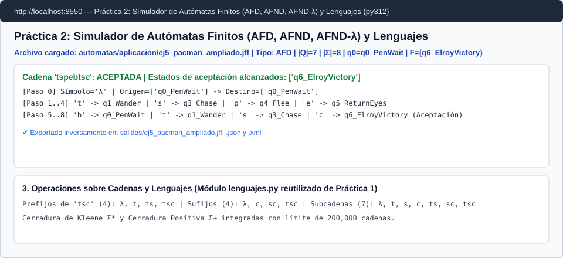

# Ejercicio 3. Simulador de autómatas con interfaz gráfica

## 1. Arquitectura modular (Separación entre núcleo e interfaz)

Manteniendo la arquitectura limpia establecida en la Práctica 1, el simulador de la Práctica 2 separa estrictamente la lógica formal de autómatas y el procesamiento de archivos respecto a la capa de presentación en Flet:

| Módulo | Dependencias de Flet | Responsabilidad principal |
| :--- | :---: | :--- |
| [`src/lenguajes.py`](../src/lenguajes.py) | **Ninguna** (Puro) | Operaciones sobre cadenas y lenguajes reutilizadas de la Práctica 1 (`prefijos`, `sufijos`, `subcadenas`, `cerradura_kleene`, `cerradura_positiva` con cota de $200,000$ cadenas). |
| [`src/automata.py`](../src/automata.py) | **Ninguna** (Puro) | Clase `AutomataFinito` (quíntupla $M = (Q, \Sigma, \delta, q_0, F)$), detección automática de tipo (`AFD`, `AFND`, `AFND-lambda`), cálculo de $\lambda$-clausura por BFS, simulación paso a paso con rastro de bifurcaciones y conversiones $\text{AFND-}\lambda \to \text{AFND} \to \text{AFD}$. |
| [`src/formatos.py`](../src/formatos.py) | **Ninguna** (Puro) | Importación y exportación inversa en los tres formatos del Anexo 3: `.jff` (JFLAP 7.1), `.json` y `.xml`. |
| [`src/app.py`](../src/app.py) | `flet[web]==0.86.5` | Interfaz gráfica web servida en el puerto `8550` del contenedor `py312` que integra la definición interactiva, importación/exportación, simulación paso a paso y operaciones de lenguajes. |

---

## 2. Decisión de diseño para simular autómatas no deterministas (Sección 3.3)

El enunciado plantea elegir y justificar una de dos estrategias para simular autómatas no deterministas (AFND y AFND-$\lambda$):
* **Alternativa A (Simulación directa en línea / Seguimiento de todos los caminos y conjunto de estados activos)**, o bien
* **Alternativa B (Conversión previa completa a un AFD equivalente mediante construcción de subconjuntos y simulación del AFD)**.

### Decisión adoptada y justificación técnica
En [`src/automata.py`](../src/automata.py) (método `AutomataFinito.simular()`) **se eligió la Alternativa A (simulación directa del no determinismo siguiendo simultáneamente el conjunto de estados activos y registrando todos los caminos/bifurcaciones en los estados originales del AFND/AFND-$\lambda$)**, ofreciendo además en la interfaz un botón dedicado (*"Convertir a AFD Equivalente"*) cuando el usuario desea materializar la Alternativa B.

**Razones de la elección**:
1. **Fidelidad pedagógica y trazabilidad de bifurcaciones**: El requisito 2.2 y 3.3 solicita mostrar en la ejecución paso a paso el estado actual, la transición tomada, las bifurcaciones y el papel de la $\lambda$-clausura sobre el autómata definido por el usuario. Si se convirtiera silenciosamente a un AFD antes de simular, la traza solo mostraría macro-estados combinados y perdería el detalle explícito de qué aristas $\lambda$ se cruzaron o en qué paso murió una rama individual.
2. **Ausencia de costo exponencial de preprocesamiento para cadenas individuales**: Cuando un usuario edita interactivamente un autómata y prueba una sola cadena $w$ de longitud moderada ($|w| \le 100$), simular directamente sobre el AFND evita pagar el tiempo y espacio potencialmente exponencial $O(2^{|Q|})$ de construir todo el AFD accesible por adelantado (Hopcroft et al., 2007; Aho et al., 2006).

### Comparación del coste computacional (tiempo y espacio) de cada alternativa

Sea $n = |Q|$ el número de estados del AFND (o AFND-$\lambda$), $m = |\delta|$ el número de transiciones, $|\Sigma|$ el tamaño del alfabeto y $|w|$ la longitud de la cadena de entrada:

| Métrica de Complejidad | Alternativa A: Simulación directa siguiendo todos los caminos / estados activos (Elegida) | Alternativa B: Conversión previa a AFD (Subconjuntos) y simulación en el AFD |
| :--- | :--- | :--- |
| **Costo de preprocesamiento** | **$O(1)$** (nulo; simula directamente sobre la estructura cargada). | **$O(2^n \cdot n \cdot |\Sigma|)$** en tiempo y **$O(2^n \cdot |\Sigma|)$** en espacio en el peor caso para construir la tabla del AFD. |
| **Tiempo de simulación por símbolo leído** | **$O(n^2)$** (o $O(n + m)$ usando BFS para calcular $\bigcup_{q \in S} \delta(q, a)$ y su $\lambda$-clausura). | **$O(1)$** (una sola consulta de tabla hash/arreglo $\delta_D(S, a)$). |
| **Tiempo total para validar una cadena de longitud $|w|$** | **$O(|w| \cdot n^2)$** manteniendo el conjunto de estados activos (y hasta $O(b^{|w|})$ si se enumeran explícitamente todos los árboles de caminos sin podar). | **$O(2^n \cdot n \cdot |\Sigma| + |w|)$**. |
| **Memoria RAM requerida durante la simulación** | **$O(n)$** para almacenar el subconjunto activo actual $S \subseteq Q$. | **$O(2^n \cdot |\Sigma|)$** para mantener en memoria la tabla de transiciones del AFD. |
| **Cuándo conviene cada una** | Óptima en **simuladores interactivos** donde el autómata cambia con frecuencia y se inspeccionan trazas sobre cadenas cortas o medianas. | Óptima en **analizadores léxicos de compiladores y motores de red** donde un mismo autómata fijo procesa gigabytes de texto millones de veces. |

---

## 3. Convención sobre la transición $\lambda$ en los tres formatos de archivo (Anexo 3)

De acuerdo con el Anexo 3, tanto en `.jff` como en `.json` y `.xml`, **la transición $\lambda$ se representa en los archivos mediante la cadena vacía `""` como símbolo leído**:
* En **`.jff`**: etiqueta `<read/>` vacía (o `<read></read>`).
* En **`.json`**: `"lee": ""` dentro del objeto de transición `{ "desde": "q0", "lee": "", "hacia": ["q1"] }`.
* En **`.xml`**: atributo `lee=""` dentro del elemento `<transicion desde="q0" lee="" hacia="q1"/>`.

En la interfaz gráfica ([`src/app.py`](../src/app.py)), el usuario puede escribir indistintamente `λ`, `lambda`, `ε` o dejar vacío el símbolo en la tabla editable, y el módulo [`src/formatos.py`](../src/formatos.py) lo normaliza internamente a `""` para garantizar que la exportación y la importación sean funciones inversas exactas:

$$\text{importar\_formato}(\text{exportar\_formato}(M)) = M$$

---

## 4. Evidencia del Simulador en Ejecución (`py312`)

<!-- Verificado en rama feature/exportar-json-xml para Pull Request #3 -->
