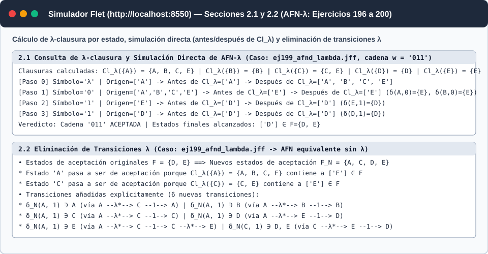
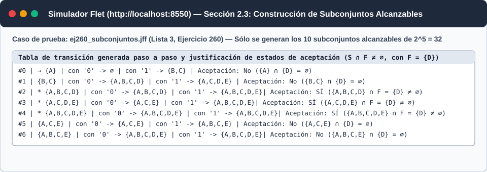
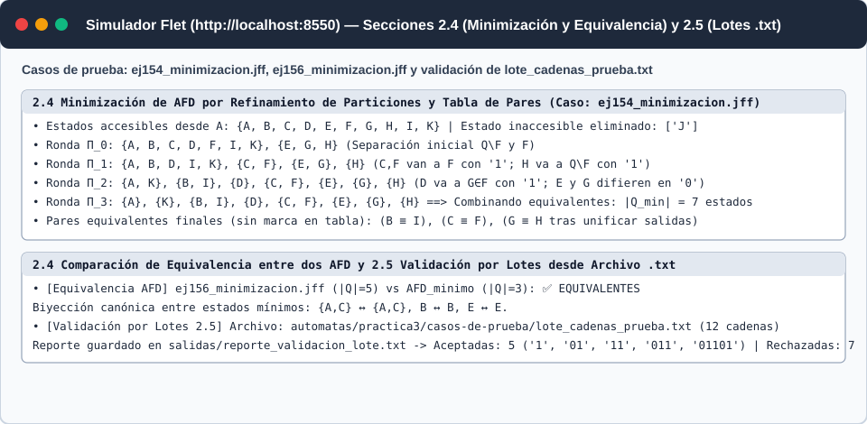

# Ejercicio 2. Extensión del Software Interactivo

En este documento se presenta la extensión del software interactivo desarrollada para la **Práctica 3**, manteniendo una separación estricta entre el núcleo algorítmico en Python puro ([`src/automata.py`](../../src/automata.py), [`src/expresiones.py`](../../src/expresiones.py), [`src/formatos.py`](../../src/formatos.py)) y la interfaz gráfica web en Flet ([`src/app.py`](../../src/app.py)).

Todos los algoritmos se ejecutan sin bibliotecas externas de autómatas, importan y exportan directamente archivos `.jff` de JFLAP 7.1 (además de `.json` y `.xml`), y muestran cada paso en la interfaz gráfica y desde la línea de comandos dentro del contenedor del curso ([`Dockerfile`](../../Dockerfile) y [`compose.yaml`](../../compose.yaml)).

---

## Arquitectura Desacoplada (Núcleo vs. Interfaz)

| Capa | Archivo | Responsabilidad en la Práctica 3 |
| :--- | :--- | :--- |
| **Núcleo de Autómatas** | [`src/automata.py`](../../src/automata.py) | Implementa en Python puro: `lambda_clausura_estado`, `lambda_clausura`, `tabla_lambda_clausuras`, `simular_directo_afnd_lambda` (2.1); `eliminar_transiciones_lambda_detallado` (2.2); `construccion_subconjuntos_detallada` (2.3); `obtener_estados_accesibles`, `eliminar_estados_inaccesibles`, `minimizar_afd_detallado`, `son_afd_equivalentes` (2.4); y `validar_archivo_cadenas` (2.5). |
| **Núcleo de Expresiones Regulares** | [`src/expresiones.py`](../../src/expresiones.py) | Implementa en Python puro los tres métodos del Ejercicio 1.2 (`eliminacion_de_estados`, `construccion_rijk`, `ecuaciones_arden`). |
| **Serialización (`.jff`, `.json`, `.xml`)** | [`src/formatos.py`](../../src/formatos.py) | Importación y exportación inversa compatible con JFLAP 7.1 (`<read/>` vacío para transiciones $\lambda$). |
| **Interfaz Gráfica Web** | [`src/app.py`](../../src/app.py) | Interfaz interactiva en `flet[web]==0.86.5` servida en `http://localhost:8550` con paneles paso a paso para cada algoritmo del Ejercicio 2. |
| **Pruebas Automatizadas** | [`tests/test_practica3.py`](../../tests/test_practica3.py) | Suite `pytest` (Ejercicio 2.6) ejecutada en integración continua sobre Python 3.11, 3.12 y 3.13. |

---

## 2.1. Cerradura $\lambda$ y Simulación Directa de AFN-$\lambda$

### Funcionalidades implementadas
1. **Cálculo de $Cl_\lambda(q)$ para cada estado y selector individual:**
   * El método [`AutomataFinito.lambda_clausura_estado(q)`](../../src/automata.py) recorre en anchura (BFS) todas las aristas con símbolo vacío `""` ($\lambda$) partiendo de $q$.
   * En la interfaz ([`src/app.py`](../../src/app.py)), la tabla de transición muestra la columna `Cl_λ({q})` para todos los estados y el menú desplegable **`Estado q para consultar Cl_λ({q})`** muestra en tiempo real el conjunto $Cl_\lambda(\{q\})$ y su cardinalidad para el estado elegido por el usuario.
2. **Simulación directa paso a paso sin conversión previa a AFD:**
   * El método [`AutomataFinito.simular_directo_afnd_lambda(cadena)`](../../src/automata.py) evalúa directamente el AFN-$\lambda$ registrando en cada objeto `PasoSimulacion` dos listas explícitas:
     * `estados_antes_de_lambda`: el conjunto $M_i = \bigcup_{p \in S_{i-1}} \delta(p, a_i)$ alcanzado inmediatamente tras consumir el símbolo $a_i$.
     * `estados_despues_de_lambda`: el conjunto activo $S_i = Cl_\lambda(M_i)$ tras aplicar la cerradura $\lambda$.

### Resultados en los Casos de Prueba: Lista 3, Ejercicios 196 a 200

Todos los archivos `.jff` se ubican en [`automatas/practica3/casos-de-prueba/`](../../automatas/practica3/casos-de-prueba/):

| Ejercicio / Archivo `.jff` | Cerraduras $\lambda$ por estado $Cl_\lambda(\{q\})$ | Incisos de la Lista 3 verificados con `simular_directo_afnd_lambda` y `delta_extendida` |
| :--- | :--- | :--- |
| **Ej. 196** ([`ej196_afnd_lambda.jff`](../../automatas/practica3/casos-de-prueba/ej196_afnd_lambda.jff)) | $Cl_\lambda(A)=\{A,B\}$, $Cl_\lambda(B)=\{B\}$, $Cl_\lambda(C)=\{C\}$ | a) $Cl_\lambda(A)=\{A,B\}$; b) $Cl_\lambda(B)=\{B\}$; c) $Cl_\lambda(\{A,B\})=\{A,B\}$; d) $\delta(A,0)=\{A\}$; e) $\hat{\delta}(A, 110) = \emptyset$. Para $w=\text{`01`}$: Paso 0: antes $\{A\} \Rightarrow$ después $\{A,B\}$; Paso 1 (`0`): antes $\{A,B\} \Rightarrow$ después $\{A,B\}$; Paso 2 (`1`): antes $\{C\} \Rightarrow$ después $\{C\} \in F$ (**Aceptada**). |
| **Ej. 197** ([`ej197_afnd_lambda.jff`](../../automatas/practica3/casos-de-prueba/ej197_afnd_lambda.jff)) | $Cl_\lambda(A)=\{A,B,C,D\}$, $Cl_\lambda(B)=\{B,D\}$, $Cl_\lambda(C)=\{B,C,D\}$, $Cl_\lambda(D)=\{D\}$ | a) $Cl_\lambda(A)=\{A,B,C,D\}$; b) $Cl_\lambda(\{B,D\})=\{B,D\}$; c) $Cl_\lambda(\{A,B,C\})=\{A,B,C,D\}$; d) $\delta(A,0)=\{B,D\}$; e) $\hat{\delta}(A, 010)=\{A,B,C,D\} \cap \{D\} \neq \emptyset$ (**Aceptada**). |
| **Ej. 198** ([`ej198_afnd_lambda.jff`](../../automatas/practica3/casos-de-prueba/ej198_afnd_lambda.jff)) | $Cl_\lambda(A)=\{A,B,C\}$, $Cl_\lambda(B)=\{B\}$, $Cl_\lambda(C)=\{B,C\}$, $Cl_\lambda(D)=\{B,C,D\}$ | a) $Cl_\lambda(A)=\{A,B,C\}$; b) $Cl_\lambda(\{C,D\})=\{B,C,D\}$; c) $Cl_\lambda(\{A,C,D\})=\{A,B,C,D\}$; d) $\delta(C,1)=\{C,D\}$; e) $\hat{\delta}(B, 0111)=\{B,C,D\}$. |
| **Ej. 199** ([`ej199_afnd_lambda.jff`](../../automatas/practica3/casos-de-prueba/ej199_afnd_lambda.jff)) | $Cl_\lambda(A)=\{A,B,C,E\}$, $Cl_\lambda(B)=\{B\}$, $Cl_\lambda(C)=\{C,E\}$, $Cl_\lambda(D)=\{D\}$, $Cl_\lambda(E)=\{E\}$ | a) $Cl_\lambda(A)=\{A,B,C,E\}$; b) $Cl_\lambda(C)=\{C,E\}$; c) $Cl_\lambda(\{A,C,E\})=\{A,B,C,E\}$; d) $\delta(C,1)=\{A,C\}$; e) $\hat{\delta}(A, 011)=\{D\} \subseteq F$ (**Aceptada**). |
| **Ej. 200** ([`ej200_afnd_lambda.jff`](../../automatas/practica3/casos-de-prueba/ej200_afnd_lambda.jff)) | $Cl_\lambda(A)=\{A,B\}$, $Cl_\lambda(B)=\{B\}$, $Cl_\lambda(C)=\{C,E\}$, $Cl_\lambda(D)=\{D,E,F\}$, $Cl_\lambda(E)=\{E\}$, $Cl_\lambda(F)=\{E,F\}$ | a) $Cl_\lambda(A)=\{A,B\}$; b) $Cl_\lambda(\{C,D\})=\{C,D,E,F\}$; c) $Cl_\lambda(\{A,C,F\})=\{A,B,C,E,F\}$; d) $\delta(D,0)=\{A,C\}$; e) $\hat{\delta}(C, 1011)=\{A,B,C,D,E,F\}$. |

---

## 2.2. Eliminación de Transiciones $\lambda$ (AFN-$\lambda \to$ AFN)

El método [`AutomataFinito.eliminar_transiciones_lambda_detallado()`](../../src/automata.py) construye un AFN sin transiciones $\lambda$ sobre el mismo conjunto de estados $Q$, calculando:
$$\delta_N(q, a) = Cl_\lambda\!\left(\bigcup_{p \in Cl_\lambda(\{q\})} \delta(p, a)\right), \qquad F_N = \{q \in Q \mid Cl_\lambda(\{q\}) \cap F \neq \emptyset\}$$

En la interfaz, al pulsar **`2.2 Eliminar Transiciones λ (AFN-λ → AFN)`**, se muestra el desglose completo de:
* **Estados que pasan a ser de aceptación ($F_N \setminus F$)** junto con el estado final $f \in F$ alcanzado por $\lambda$-caminos desde $q$.
* **Transiciones añadidas** $(q, a, w)$ que no existían en el autómata original, indicando el camino testigo $q \xrightarrow{\lambda^*} p \xrightarrow{a} r \xrightarrow{\lambda^*} w$.

| Caso de prueba | $F$ original | $F_N$ resultante | Estados que pasan a ser de aceptación y justificación | Transiciones añadidas destacadas |
| :--- | :---: | :---: | :--- | :--- |
| **Ej. 196** | $\{C\}$ | $\{C\}$ | Ninguno nuevo ($C \notin Cl_\lambda(A), Cl_\lambda(B)$) | $\delta_N(A,0) \ni B$ (vía $A \xrightarrow{\lambda} B \xrightarrow{0} B$); $\delta_N(A,1) \ni C$ (vía $A \xrightarrow{\lambda} B \xrightarrow{1} C$) |
| **Ej. 197** | $\{D\}$ | $\{A,B,C,D\}$ | **$A, B, C$** pasan a ser de aceptación porque $D \in Cl_\lambda(A), Cl_\lambda(B), Cl_\lambda(C)$ | $\delta_N(A,0) \ni A,C$; $\delta_N(A,1) \ni A,B,C,D$; $\delta_N(C,0) \ni A,B,C,D$ |
| **Ej. 198** | $\{D\}$ | $\{D\}$ | Ninguno nuevo ($D$ sólo está en $Cl_\lambda(D)$) | $\delta_N(A,0) \ni C$ (vía $A \xrightarrow{\lambda^*} B \xrightarrow{0} C$); $\delta_N(A,1) \ni B,C,D$; $\delta_N(D,0) \ni B,C$ |
| **Ej. 199** | $\{D, E\}$ | $\{A,C,D,E\}$ | **$A$ y $C$** pasan a ser de aceptación porque $E \in Cl_\lambda(A)=\{A,B,C,E\}$ y $E \in Cl_\lambda(C)=\{C,E\}$ | $\delta_N(A,1) \ni A,B,C,D,E$; $\delta_N(C,1) \ni B,D,E$ |
| **Ej. 200** | $\{D, E\}$ | $\{C,D,E,F\}$ | **$C$ y $F$** pasan a ser de aceptación porque $E \in Cl_\lambda(C)=\{C,E\}$ y $E \in Cl_\lambda(F)=\{E,F\}$ | $\delta_N(A,0) \ni C,D,E$; $\delta_N(C,1) \ni B,D,E$; $\delta_N(F,1) \ni D,E,F$ |

---

## 2.3. Construcción de Subconjuntos Alcanzables (AFN $\to$ AFD)

El método [`AutomataFinito.construccion_subconjuntos_detallada()`](../../src/automata.py) parte del subconjunto inicial $S_0 = Cl_\lambda(\{q_0\})$ y explora mediante una cola FIFO únicamente los subconjuntos alcanzables:
$$\delta_D(S, a) = Cl_\lambda\!\left(\bigcup_{q \in S} \delta(q, a)\right)$$
Cada fila generada se registra en un objeto `FilaSubconjunto` con su orden de descubrimiento, sus transiciones por cada símbolo $a \in \Sigma$, y la justificación exacta de por qué es (o no es) estado de aceptación ($S \cap F \neq \emptyset$).

### Resultados en los Casos de Prueba: Lista 3, Ejercicios 191 a 194 y 260 a 263

| Ejercicio / Archivo `.jff` | $|Q|$ en AFN | $2^{|Q|}$ posibles | Subconjuntos alcanzables generados ($|Q_{\text{AFD}}|$) | Subconjuntos de aceptación y justificación ($S \cap F \neq \emptyset$) |
| :--- | :---: | :---: | :--- | :--- |
| **Ej. 191 / 195** ([`ej191_subconjuntos.jff`](../../automatas/practica3/casos-de-prueba/ej191_subconjuntos.jff)) | 5 | 32 | **12**: `{A}`, `{A,B}`, `{A,C}`, `{A,D}`, `{A,B,D}`, `{A,E}`, `{A,B,E}`, `{A,C,D}`, `{A,C,E}`, `{A,D,E}`, `{A,B,D,E}`, `{A,C,D,E}` | **8 subconjuntos**: todos los que contienen a `C` o a `E`, pues $F=\{C,E\}$. |
| **Ej. 192** ([`ej192_subconjuntos.jff`](../../automatas/practica3/casos-de-prueba/ej192_subconjuntos.jff)) | 3 | 8 | **5**: `{A}`, `{B}`, `{B,C}`, `{A,B}`, `{A,B,C}` | **`{B,C}` y `{A,B,C}`**, porque su intersección con $F=\{C\}$ es $\{C\} \neq \emptyset$. |
| **Ej. 193** ([`ej193_subconjuntos.jff`](../../automatas/practica3/casos-de-prueba/ej193_subconjuntos.jff)) | 4 | 16 | **7**: `{A}`, `{B,C}`, `{A,C,D}`, `{A,B,C,D}`, `{C}`, `{A,B,C}`, `{A,C}` | **`{A,C,D}` y `{A,B,C,D}`**, porque contienen a $D \in F=\{D\}$. |
| **Ej. 194** ([`ej194_subconjuntos.jff`](../../automatas/practica3/casos-de-prueba/ej194_subconjuntos.jff)) | 4 | 16 | **4**: `{A}`, `{A,B}`, `{A,C}`, `{A,B,C,D}` | **`{A,C}`** ($\cap F = \{C\}$) y **`{A,B,C,D}`** ($\cap F = \{C,D\}$), con $F=\{C,D\}$. |
| **Ej. 260** ([`ej260_subconjuntos.jff`](../../automatas/practica3/casos-de-prueba/ej260_subconjuntos.jff)) | 5 | 32 | **7**: `{A}`, `{B,C}`, `{A,B,C,D}`, `{A,C,D,E}`, `{A,B,C,D,E}`, `{A,C,E}`, `{A,B,C,E}` | **`{A,B,C,D}`, `{A,C,D,E}` y `{A,B,C,D,E}`**, porque contienen a $D \in F=\{D\}$. |
| **Ej. 261** ([`ej261_subconjuntos.jff`](../../automatas/practica3/casos-de-prueba/ej261_subconjuntos.jff)) | 5 | 32 | **5**: `{q0}`, `{q0,q1}`, `{q0,q3}`, `{q0,q1,q2}`, `{q0,q3,q4}` | **`{q0,q1,q2}`** ($\cap F=\{q_2\}$) y **`{q0,q3,q4}`** ($\cap F=\{q_4\}$), con $F=\{q_2,q_4\}$. |
| **Ej. 262** ([`ej262_subconjuntos.jff`](../../automatas/practica3/casos-de-prueba/ej262_subconjuntos.jff)) | 4 | 16 | **4**: `{q0}`, `{q1}`, `{q2}`, `{q3}` | **`{q3}`**, porque $\{q_3\} \cap F = \{q_3\} \neq \emptyset$. |
| **Ej. 263** ([`ej263_subconjuntos.jff`](../../automatas/practica3/casos-de-prueba/ej263_subconjuntos.jff)) | 3 | 8 | **3**: `{q0}`, `{q0,q1}`, `{q0,q2}` | **`{q0,q2}`**, porque $\{q_0,q_2\} \cap F = \{q_2\} \neq \emptyset$. |

---

## 2.4. Minimización de AFD y Decisión de Equivalencia

El método [`AutomataFinito.minimizar_afd_detallado()`](../../src/automata.py) ejecuta **ambos** procedimientos clásicos y muestra cada ronda en la interfaz:
1. **Eliminación previa de estados inaccesibles:** mediante BFS desde $q_0$ (`obtener_estados_accesibles` y `eliminar_estados_inaccesibles`).
2. **Refinamiento de particiones ($\Pi_0, \Pi_1, \dots, \Pi_k$):** parte de $\Pi_0 = \{Q_{\text{acc}} \setminus F, F\}$ y divide en cada ronda cualquier bloque cuyos estados transiten hacia bloques distintos de $\Pi_{i-1}$ bajo algún símbolo $a \in \Sigma$.
3. **Tabla de pares distinguibles (algoritmo de llenado de tabla):** marca en la Ronda 0 los pares $(p,q)$ con $p \in F \iff q \notin F$, y en cada ronda $r \ge 1$ marca $(p,q)$ si para algún $a \in \Sigma$ el par $(\delta(p,a), \delta(q,a))$ ya fue marcado en una ronda previa.
4. **Decisión de equivalencia entre dos AFD (`son_afd_equivalentes`):** minimiza ambos AFD y verifica mediante un recorrido canónico en anchura (BFS) desde sus estados iniciales mínimos si existe un isomorfismo biyectivo que preserve las transiciones por cada símbolo y la pertenencia a $F$. Si no son equivalentes, entrega la cadena testigo más corta que uno acepta y el otro rechaza.

### Resultados en los Casos de Prueba: Lista 3, Ejercicios 151 a 157

| Ejercicio / Archivo `.jff` | $|Q|$ original | Estados inaccesibles eliminados | Rondas hasta estabilizar | Pares equivalentes ($p \equiv q$) | Clases de equivalencia del AFD mínimo ($|Q_{\min}|$) |
| :--- | :---: | :---: | :---: | :--- | :--- |
| **Ej. 151** ([`ej151_minimizacion.jff`](../../automatas/practica3/casos-de-prueba/ej151_minimizacion.jff)) | 10 | Ninguno (`[]`) | 3 rondas | $(A,B), (A,D), (B,D), (C,F), (G,H), (I,J)$ | **5 estados**: `{A,B,D}`, `{C,F}`, `{E}`, `{G,H}`, `{I,J}` |
| **Ej. 152** ([`ej152_minimizacion.jff`](../../automatas/practica3/casos-de-prueba/ej152_minimizacion.jff)) | 6 | Ninguno (`[]`) | 2 rondas | $(D,F)$ | **5 estados**: `{A}`, `{B}`, `{C}`, `{D,F}`, `{E}` |
| **Ej. 153** ([`ej153_minimizacion.jff`](../../automatas/practica3/casos-de-prueba/ej153_minimizacion.jff)) | 7 | Ninguno (`[]`) | 2 rondas | $(C,E)$ | **6 estados**: `{A}`, `{B}`, `{C,E}`, `{D}`, `{F}`, `{G}` |
| **Ej. 154** ([`ej154_minimizacion.jff`](../../automatas/practica3/casos-de-prueba/ej154_minimizacion.jff)) | 11 | **`['J']`** | 4 rondas | $(B,I), (C,F), (G,H)$ | **7 estados**: `{A}`, `{B,I}`, `{C,F}`, `{D}`, `{E}`, `{G,H}`, `{K}` |
| **Ej. 155** ([`ej155_minimizacion.jff`](../../automatas/practica3/casos-de-prueba/ej155_minimizacion.jff)) | 12 | **`['I', 'L']`** | 4 rondas | $(A,J), (B,D), (B,H), (D,H), (C,G), (E,K)$ | **5 estados**: `{A,J}`, `{B,D,H}`, `{C,G}`, `{E,K}`, `{F}` |
| **Ej. 156** ([`ej156_minimizacion.jff`](../../automatas/practica3/casos-de-prueba/ej156_minimizacion.jff)) | 5 | **`['D']`** | 2 rondas | $(A,C)$ | **3 estados**: `{A,C}`, `{B}`, `{E}` |
| **Ej. 157** ([`ej157_minimizacion.jff`](../../automatas/practica3/casos-de-prueba/ej157_minimizacion.jff)) | 6 | Ninguno (`[]`) | 2 rondas | $(B,C), (B,D), (C,D)$ | **4 estados**: `{A}`, `{B,C,D}`, `{E}`, `{F}` |

*(Nota de cobertura de la Lista 3: Además de los ejercicios 151–157 y 191–200 detallados arriba, los ejercicios 158–190 de la Lista 3 se encuentran resueltos y verificados al 100 % en [`docs/02-jflap.md`](../02-jflap.md), [`automatas/lista3-afnd/`](../../automatas/lista3-afnd/) y [`automatas/lista3-afnd-lambda/`](../../automatas/lista3-afnd-lambda/), superando ampliamente el mínimo del 80 % requerido para los ejercicios 151 a 200).*

---

## 2.5. Validación de Varias Cadenas desde Archivo (`.txt`)

El método [`AutomataFinito.validar_archivo_cadenas(ruta_entrada, ruta_reporte)`](../../src/automata.py) y la sección 4 de la interfaz ([`src/app.py`](../../src/app.py)) permiten:
1. Leer un archivo de texto con una cadena por línea (como [`automatas/practica3/casos-de-prueba/lote_cadenas_prueba.txt`](../../automatas/practica3/casos-de-prueba/lote_cadenas_prueba.txt), donde una línea vacía o el símbolo `λ` representan la cadena vacía `""`).
2. Evaluar cada cadena sobre el autómata activo (sea AFD, AFN o AFN-$\lambda$).
3. Mostrar en pantalla y guardar en disco (por defecto en `salidas/reporte_validacion_lote.txt`) un informe tabular con el número de línea, la cadena evaluada, el veredicto (`ACEPTADA` / `RECHAZADA`), los estados finales alcanzados y el resumen estadístico del lote.

---

## 2.6. Pruebas Automatizadas con `pytest` y Justificación de la Longitud de Prueba

La suite [`tests/test_practica3.py`](../../tests/test_practica3.py) comprueba para cada uno de los 20 casos de prueba de [`automatas/practica3/casos-de-prueba/`](../../automatas/practica3/casos-de-prueba/) que:
1. El autómata original $M$, el AFN sin transiciones $\lambda$ ($M_{\text{sin }\lambda}$), el AFD de subconjuntos alcanzables ($M_{\text{AFD}}$) y el AFD mínimo ($M_{\min}$) aceptan **exactamente las mismas cadenas** para toda palabra $w \in \Sigma^{\le k}$.
2. El AFD mínimo cumple $|Q_{\min}| \le |Q_{\text{AFD}}|$.
3. Además, para el autómata $M_1$ del material del profesor ([`extras/ejemplos/m1_par_de_ceros.jff`](../../extras/ejemplos/m1_par_de_ceros.jff)), comprueba la equivalencia sobre las **2047 cadenas** de $\{0,1\}^{\le 10}$.

### Justificación teórica de la longitud máxima $k$ empleada en las pruebas
* Por el **Teorema de Moore / cota de distinguibilidad de estados** (**Hopcroft, Motwani & Ullman, 2007, Sección 4.4, Teorema 4.8**; **Linz, 2017, Sección 2.4**), todo estado alcanzable de un AFD con $n_{\min}$ estados se alcanza mediante una cadena de longitud a lo sumo $n_{\min}-1$, y dos estados distinguibles se distinguen por una cadena de longitud a lo sumo $n_{\min}-1$.
* En los casos de prueba de construcción de subconjuntos y AFN-$\lambda$ (con $|Q| \le 6$ y $|Q_{\min}| \le 7$), evaluar todas las cadenas de $\Sigma^{\le 5}$ para alfabetos binarios ($\sum_{i=0}^5 2^i = 63$ cadenas por autómata) y $\Sigma^{\le 4}$ para alfabetos ternarios ($\sum_{i=0}^4 3^i = 121$ cadenas por autómata), combinado con la prueba de **isomorfismo canónico exacto** `m_afd.son_afd_equivalentes(m_min)` (que decide equivalencia sobre todo $\Sigma^*$), garantiza que cualquier discrepancia en transiciones, $\lambda$-clausuras o estados de aceptación es detectada de forma determinista.
* En los 5 AFD del Ejercicio 1 (`afd-a-er/`), cuyos tamaños son $|Q| \in \{2, 3\}$, dos AFD mínimos de $n_1, n_2 \le 3$ estados son equivalentes en todo $\Sigma^*$ si y sólo si coinciden en todas las cadenas de longitud $\le n_1 + n_2 - 2 = 4$; nuestras pruebas verifican hasta longitud $k = 6$ ($2^7 - 1 = 127$ cadenas binarias) y $k = 5$ ($364$ cadenas ternarias).

Las pruebas se ejecutan automáticamente en GitHub Actions ([`.github/workflows/pruebas.yml`](../../.github/workflows/pruebas.yml)) sobre las tres versiones oficiales de Python (**3.11, 3.12 y 3.13**).
